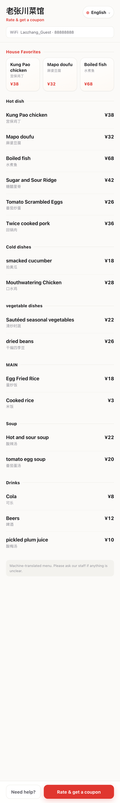
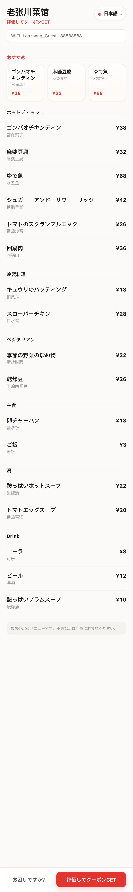
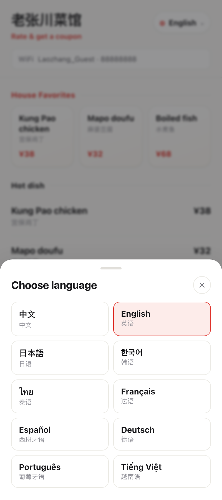
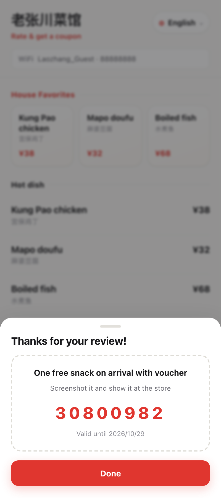

# LangCross 商家店端（langcross-merchant-app）

> **能言翻译助手** · 面向跨境客流的多语言经营 SaaS —— 商家店端落地包
>
> 一句话：帮餐厅等有跨境客流的商户，用「多语菜单物料 + 店端实时互译 + 饮食知识层（过敏原/辣度/宗教）」接住语言不通的外国客人，把本来会走的客人变成成交。

---

## 本期跑通的闭环（P0a 最小可用版）

```
商家上线（引导流 P1–P5）
   → 多语菜单 /s/{slug}
      → 客人扫码
         → 评价领券（三维度：菜品 / 服务 / 会再来吗）
            → 到店核销
               → 经营洞察
```

**明确不做**（二期）：在线支付、改收银、接 POS、外卖对接、小程序原生、多店后台。

---

## 技术栈

| 层 | 选型 | 说明 |
|---|---|---|
| 后端 | **Go 1.22+**（标准库 `net/http`，方法+通配符路由） | 无 Web 框架依赖 |
| 数据库 | **PostgreSQL** | 本期不上 pgvector，单店菜单用文本相似度足够 |
| 前端 | **React 18 + TypeScript + Vite** | 客人端 H5 与商家端后台同一应用、按路由分端 |
| 二维码 | `github.com/skip2/go-qrcode` | 门口码 / 桌码 PNG |
| OCR | **可插拔**：默认 stub（前端走手动保底）→ 生产接 Python PaddleOCR 微服务 | 服务端识别，端侧无 OCR |
| 翻译 | **可插拔三层**：TM 缓存 → 既有翻译链（生产）／MyMemory（本地开发）→ 内置词典（离线兜底） | **10 语种**；未命中的词返回空，**不编造** |

### 多语言（10 语种）

| Tier | 语种 | 口径 |
|---|---|---|
| 1 · 承诺质量 | `zh` `en` | 对外可承诺 |
| 2 · 较好 | `ja` `ko` `th` | 主客源国，优先保证 |
| 3 · 尽力而为 | `fr` `es` `de` `pt` `vi` | 机器翻译直出，页面如实标注「机器翻译」 |

- 语种清单的唯一真值在 `server/internal/service/lang.go` 的 `SupportedLangs`；**新增语种 = 登记一行**，业务代码零改动。
- 菜名存 `dish.names_json`、分类名存 `store.category_names`（都是 JSONB）；`name_zh` 始终是原文真值。
- ★ **渲染纪律**：页面主标题**永远是目标语言**，原文只作小字辅助；译文缺失时显示原文并明确标注「未翻译」，**绝不让中文冒充外语大字**。
- 设计细节见 `商家店端方案/多语言能力设计_10语种与客人端渲染规范.md`。

---

## 快速开始

```bash
# 0) 依赖：Go 1.22+、Node 18+、PostgreSQL

# 1) 建库
createdb langcross

# 2) 起后端（启动时自动执行迁移）
cd server
LC_DATABASE_URL="postgres://localhost:5432/langcross?sslmode=disable" go run ./cmd/api

# 3) 起前端
cd web && npm install && npm run dev
```

| 入口 | 地址 |
|---|---|
| 商家端后台 | http://localhost:5173/admin |
| 引导流 P1–P5 | http://localhost:5173/admin/onboarding |
| 客人端门店页 | http://localhost:5173/s/{slug} |

**端到端冒烟测试**（后端启动后）：

```bash
bash server/scripts/smoke.sh
```

覆盖：健康检查 → 验证码 → 登录 → 建店（自动配券+双码）→ 保存确认稿 → 未确认拒绝翻译 → 确认 → **语种注册表** → **一次多语化（5 语种）** → **注册前多语预览（含分类名）** → 公开门店页 → 评价领券 → 核销 → 重复核销拒绝 → 经营洞察 → 双码 PNG。

**演示门店播种**（造一家 17 道菜 / 6 分类 / 9 语种全开的店，用于人工验收）：

```bash
bash server/scripts/seed_demo.sh          # 结束时会打印门店页 URL
```

---

## 界面

客人端门店页（同一家店、同一份数据，切语言即整页切换）：

| English | 日本語 | ไทย |
|---|---|---|
|  |  |  |

| 语言选择器（10 语种） | 译文缺失 → 诚实标注「未翻译」 | 评价 → 领券 |
|---|---|---|
|  |  |  |

> 截图由 `docs/screenshots/` 下的脚本产物，门店为 `bash server/scripts/seed_demo.sh` 播种的演示店。

---

## 目录结构

```
langcross-merchant-app/
├── server/                       # Go 后端
│   ├── cmd/api/main.go           # 入口：连库 → 迁移 → 装配 → 启动
│   ├── internal/
│   │   ├── config/               # 环境变量配置
│   │   ├── db/                   # 连接池 + 迁移执行器
│   │   ├── domain/               # 领域模型
│   │   ├── repo/                 # 数据访问层（全部 SQL 集中在此）
│   │   ├── service/              # 外部能力抽象：OCR / 翻译（10 语种）/ 二维码
│   │   ├── idgen/                # 随机 ID 与券码
│   │   └── httpapi/              # 路由 / 鉴权 / 处理器
│   ├── migrations/               # SQL 迁移（embed 进二进制）
│   │   ├── 0001_init.sql         # 10 张核心表
│   │   ├── 0002_i18n.sql         # dish.names_json + translation_cache
│   │   └── 0003_category_i18n.sql# store.category_names
│   └── scripts/
│       ├── smoke.sh              # 端到端冒烟测试
│       └── seed_demo.sh          # 演示门店播种（多语种全开）
├── web/                          # React 前端
│   └── src/
│       ├── api/client.ts         # API 客户端与类型
│       ├── guest/StorePage.tsx   # 客人端门店页（多语优先）+ 评价领券 + 券卡
│       ├── guest/i18n.ts         # 客人端 10 语种词典 + 问店员短语
│       ├── admin/AdminApp.tsx    # 商家端：概览/菜单(语种覆盖)/券核销/洞察/设置
│       ├── admin/Onboarding.tsx  # 引导流 P1–P5（P4 支持多语种预览）
│       └── styles/global.css     # 设计令牌 + 客人端/商家端样式
├── docs/API.md                   # 接口契约
├── Makefile
└── .env.example
```

---

## 写代码时必须守住的纪律

1. **安全底线**：过敏 / 宗教 / 禁忌的回答只走结构化字段与知识包，**绝不走 LLM 生成**。
2. **未确认不翻译**：原文确认稿（`source_draft`）未 `confirmed_at` 时，翻译接口一律拒绝。
3. **数据口径**：经营洞察只说「外国客点单数据」，**不说「全店经营数据」**；只做趋势 / 占比 / 排序，不编精确百分比。
4. **不编造**：翻译未命中的词返回空串，由前端回落显示原文。
5. **语言纪律**：页面主标题**永远是客人选的目标语言**；原文只作小字辅助；译文缺失时显示原文并标注「未翻译」（弱化样式），**绝不让中文冒充外语大字**。
6. **物料定死**：门店页 URL `/s/{slug}` 印在物料上后不可变。
7. **券是免费的**：券是「满意度 + 复购」两个一期核心指标唯一的客观数据源，不卡在付费墙后。
8. **兜底不依赖 WiFi**：WiFi 可选、注册后补填；未填则客人端不渲染 WiFi 行。
9. **本期无支付**：引导流 P5 = 注册（免费），不是付费；只采集付费意愿（`e_pay_intent`）。
10. **React 保留属性**：自定义组件不要用 `ref` / `key` 作为业务 prop 名（`ref="t01"` 会被当成字符串 ref 并让组件崩掉）；本仓库统一用 `refCode`。

---

## 环境变量

见 `.env.example`。全部有默认值，本地零配置可起。

| 变量 | 默认 | 说明 |
|---|---|---|
| `LC_ADDR` | `:8080` | HTTP 监听 |
| `LC_DATABASE_URL` | `postgres://localhost:5432/langcross?sslmode=disable` | DSN |
| `LC_PUBLIC_BASE_URL` | `http://localhost:8080` | 生成门店页 URL / 二维码内容 |
| `LC_SECRET` | 开发用占位值 | token 签名密钥，**生产必须换** |
| `LC_DEV` | `1` | 开发模式：验证码固定 `000000` 并回显 |
| `LC_OCR_URL` | 空 | PaddleOCR 微服务；空则走 stub |
| `LC_TRANSLATE_URL` | 空 | 既有翻译链（生产首选）；空则走 MyMemory |
| `LC_MT_EMAIL` | 空 | MyMemory 联系邮箱（可选，提升免费配额） |

---

## 与方案文档的关系

本仓库是**实现**。方案文档（《落地方案》《P0引导流_页面级设计》《件④外客服务_可执行细化》《数据模型与接口契约_全量》《UI字节级规范》等）位于项目工作区的 `商家店端方案/` 目录，权威顺序见其中《文档总索引与一致性说明》§2。

冲突时的裁定顺序：**落地方案（范围）→ 数据模型与接口契约（DDL/接口）→ 本文档（技术栈与部署）**。
